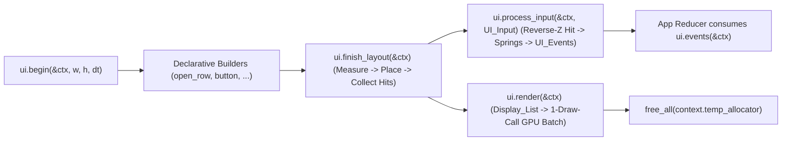

# Standalone UI Framework Architecture (`odin/ui/`)

## 1. Purpose & Design Philosophy

`odin/ui/` (`package ui`) is DreamCraft's standalone, zero-dependency declarative reactive UI framework written in pure Odin on top of Raylib / OpenGL 330. It is isolated in its own top-level package folder (`odin/ui/`) with **zero imports of `game`, `control`, or `client`** so it can be reused or extracted directly as an independent game-UI library.

It synthesizes four proven UI architectures into a game-ready design:

| Inspiration | Mechanism Adopted in `odin/ui/` |
|-------------|---------------------------------|
| **Quickshell (`Caelestia` / `Noctalia`)** | Floating islands, recessed wells, pill tracks, semantic elevation tokens, torchlit gold-leaf top specular rims, and medieval brass double-rule filigree frames (`theme.odin`, `ui_sdf.fs`). |
| **Jetpack Compose** | Code-first declarative container/leaf builders (`open_row`, `open_col`, `open_box`, `open_card`, `open_scrim_modal`, `button`, `badge`, `keycap`, `segmented_tab`) configured by chainable value `Mod` structs (`types.odin`, `builder.odin`, `widgets.odin`). |
| **Flutter** | Single-pass `BoxConstraints` (`min_w, max_w, min_h, max_h`) down the tree and `[2]f32` sizes up the tree (`measure_node` -> `place_node`), compiling into a z-layered `Display_List` with `ClipRRect` (`ui_clip_tex.fs`) and HiDPI scissor clipping (`layout.odin`, `display_list.odin`). |
| **Elm / Iced** | Unidirectional message dispatch (`UI_Input` -> reverse-z hit testing -> typed `UI_Event` queue -> application `UI_Msg` update reducer) paired with a fixed `[512]Widget_Slot` retained animation table (`hit.odin`, `memory.odin`). |

---

## 2. Package Boundary & File Map

```
odin/ui/
├── types.odin        # UI_Id (FNV-1a), Constraints, Mod value modifiers, Surface_Style, UI_Node, UI_Event
├── theme.odin        # Medieval / Levantine palette tokens, radii, surface & button/badge style factories
├── memory.odin       # Fixed [512]Widget_Slot hash table, LRU eviction, spring integrator, Context, Font_Pack
├── layout.odin       # Single-pass Flutter BoxConstraints solver (measure_node, place_node, collect_hits)
├── hit.odin          # Reverse z-layer hit testing, pointer blocking, ripple trigger, spring stepping
├── builder.odin      # Compose tree builders (begin, open_*, close, spacer, ornament_divider, label, icon)
├── widgets.odin      # High-level widgets (button, badge, keycap, segmented_tab, swatch, draw_raw_bar/pill)
├── font.odin         # Exact-pixel baked, sRGB-gamma-corrected, pure-white-RGB font engine + embedded assets
├── display_list.odin # Z-layer sorted Draw_Cmd compiler with animated hover/press/active/ripple states
├── render.odin       # 1-draw-call 512x8 texelFetch SDF batcher, ClipRRect executor, --no-shader fallback
└── ui_test.odin      # Standalone unit tests (layout, LRU memory, springs, z-hit, clip, 0-alloc guard)
```

- **Compile-Time Self-Containment**: `font.odin` embeds the SIL-OFL TrueType fonts (`#load("../assets/fonts/*.ttf")`) and GLSL 330 shaders (`#load("../assets/shaders/ui_*.{vs,fs}")`), checking disk paths first for live shader hot-tweaking and falling back to `rl.LoadShaderFromMemory` automatically.
- **Strict Code Style**: Every file in `odin/ui/` is `<= 420` lines, every procedure is `<= 50` lines, and the package passes `odin test ui -vet -strict-style` with leak tracking enabled.

---

## 3. Frame Lifecycle & Unidirectional Data Flow



1. **Input & Dispatch Step (`ui.process_input`)**:
   - Evaluates pointer position against `ctx.prev_hits` in reverse paint order (`MAX_LAYERS - 1` down to `0`, last child first).
   - Sets `ctx.pointer_blocked = true` whenever the pointer is over any `blocks_pointer` surface (floating HUD islands, toolbars, minimap card, or modal scrims) or clickable widget, preventing world click-through or marquee selection.
   - Emits `UI_Event{id, tag, arg, mouse}` into a fixed `[64]UI_Event` queue on press (`trigger_press = true`) or click release (`trigger_press = false`) and triggers an InkWell ripple at normalized local `(u, v)` coordinates.
2. **Tree Construction & Layout (`ui.begin` -> builders -> `ui.finish_layout`)**:
   - Allocates `ctx.nodes` from `context.temp_allocator` (`0` persistent heap allocations).
   - Runs `measure_node` (top-down `Constraints`, bottom-up intrinsic `[2]f32` size), `place_node` (assigning pixel-snapped `node.rect`), and `collect_hits` (populating `ctx.prev_hits` with inherited scissor clip rects).
3. **Display List Compilation & GPU Execution (`ui.render`)**:
   - Traverses `ctx.nodes` per z-layer (`0..<MAX_LAYERS`), blending each widget's `Surface_Style` with its retained `Widget_Slot` spring values (`hover_t`, `press_t`, `active_t`, `ripple_t`).
   - Flushes contiguous runs of `.SDF_Box` commands in a **single batched OpenGL draw call** (`draw_sdf_batch`).

---

## 4. Single-Pass `BoxConstraints` Layout Protocol (`layout.odin`)

- **Constraint Resolution (`resolve_constraints`)**:
  - Clamps incoming `(min_w, max_w, min_h, max_h)` by `Mod.min_w/h` and `Mod.max_w/h`.
  - Fixed `Mod.width >= 0` or `Mod.height >= 0` locks `min == max`.
  - `Mod.fill_w` / `Mod.fill_h` promotes `min_w = max_w` / `min_h = max_h` whenever bounded (`< 1e8`).
- **Flex Containers (`.Row` / `.Column` in `measure_flex`)**:
  1. Measures all unweighted children (`weight == 0`) first with remaining `main_max - fixed_main`, accumulating `fixed_main` and `max_cross`.
  2. Subtracts inter-child `gaps = gap * f32(count - 1)` and distributes remaining `avail = max(0, main_max - fixed_main - gaps)` across weighted children (`weight > 0`) proportionally (`share = avail * (weight / total_w)`).
- **Auto-Width Button Keycap Rule (`widgets.odin`)**:
  - Inside `button`, a `spacer(ctx, 1)` before `keycap` is emitted **only** when the button has explicit width allocation (`bm.fill_w || bm.width > 0 || bm.weight > 0`); auto-width buttons emit a fixed `gap_box(ctx, 4, 1)` so they never greedily expand across parent rows.

---

## 5. Retained `[512]Widget_Slot` Memory & Spring Physics (`memory.odin`)

- **Zero-Allocation Hash Table**: `ctx.slots` is a fixed `[512]Widget_Slot` open-addressed linear-probing table keyed by 64-bit FNV-1a `UI_Id` (`id("name")`, `id_idx("row", i)`, `id_combine(a, b)`).
- **LRU Eviction**: When table load exceeds 384 slots, `evict_stale_slots` reclaims slots unseen for `> 120` frames.
- **Critically-Damped Springs (`spring_step`)**:
  - Hover (`stiffness = 520, damping = 34`), press (`720, 42`), and active (`460, 32`) states integrate smoothly via semi-implicit Euler each frame, driving surface color interpolation, border brightening, and `state_lift`.
  - Click ripples advance `ripple_t` over `~0.42s` from click origin `ripple_uv`.

---

## 6. 1-Draw-Call GPU SDF Batcher & Medieval Filigree (`render.odin`, `ui_sdf.{vs,fs}`)

To render complex multi-panel RPG/RTS interfaces without draw-call overhead, `draw_sdf_batch` packs up to `MAX_DRAW_CMDS` (`512`) UI surfaces into a `512×8` RGBA8 `POINT`-filtered parameter texture (`r.data_tex`) and emits one `rlgl.QUADS` batch:

| Row (`texelFetch(texture0, ivec2(v_slot, row), 0)`) | Packed Fields (RGBA8) |
|-----------------------------------------------------|-----------------------|
| **Row 0** | Corner radii `(top_left, top_right, bottom_right, bottom_left)` in px (`0..255`) |
| **Row 1** | Border color `(R, G, B, A)` |
| **Row 2** | Half-width `hw * 4` (`u16` high/low in `R,G`) and half-height `hh * 4` (`u16` high/low in `B,A`) |
| **Row 3** | `border_w * 16` (`R`), `top_rim` (`G`), `shadow_blur / 64` (`B`), `shadow_off_y * 2 + 128` (`A`) |
| **Row 4** | Outer elevation shadow color `(R, G, B, A)` |
| **Row 5** | InkWell ripple center `(uv.x, uv.y)` (`R,G`), normalized progress `ripple_t` (`B`), ripple alpha (`A`) |
| **Row 6** | Progress bar fill ratio (`R`), mode (`0 = Card/Button, 1 = Progress`) (`G`), `state_lift` (`A`) |
| **Row 7** | Accent / progress fill color `(R, G, B, A)` |

- **Batch Overflow Guard**: Inside `emit_sdf_quad`, if `rlgl.CheckRenderBatchLimit(4)` flushes an internal buffer mid-batch, `rlgl.SetTexture(r.data_tex.id)` is immediately re-asserted so subsequent quads never lose the parameter texture binding.
- **Medieval Filigree & Corner Diamonds (`ui_sdf.fs`)**:
  - Evaluates analytical 4-corner SDF `sd_rounded_box(p, half_size, radii)` with Retina-safe derivative AA `aa = max(fwidth(d), 0.45)`.
  - Traces a warm **torchlit gold-leaf top rim** (`mix(border_col.rgb, vec3(1.0, 0.89, 0.64), 0.58)`), an **inner antique-brass filigree double-rule** inset by `2.6px`, and **45° corner diamond studs** (`abs(cp.x) + abs(cp.y) - 2.1`) on cards, islands, and modals (`min(half_size.x, half_size.y) >= 24.0`).

---

## 7. Smooth Font Rendering Engine (`font.odin`)

### Root Causes of Rough Font Rendering in Naive Raylib `DrawTextEx`
1. **Non-1:1 Texture Downsampling**: Baking a single `26px` or `48px` atlas and drawing at `11..14px` with `GL_LINEAR` (no mipmaps) skips texels (`> 2.0x` downscale) and aliases diagonal strokes.
2. **Fractional Character Spacing Drift**: Passing a fractional spacing (e.g. `size * 0.04 = 0.48px`) to `DrawTextEx` adds `+0.48px` after each integer `advanceX`, forcing every odd character onto a `x + 0.5` half-pixel boundary where `.BILINEAR` smears vertical stems across two columns.
3. **Black Transparent Atlas Background (`RGBA = 0,0,0,0`)**: Raylib's `GenImageFontAtlas` fills padding pixels with black transparent `(0,0,0,0)`, causing dark gray halos when bilinear filtering interpolates glyph edges.
4. **Linear Coverage Alpha on Dark Grounds**: `stb_truetype` outputs linear area coverage (`0..1`), which OpenGL blends directly in sRGB framebuffer space (`0.5` linear coverage renders at `~21%` perceptual luminance on dark panels), pinching curved bowls (`o, e, c, s, a`).

### How `odin/ui/font.odin` Solves All Four
1. **7-Step Exact `2×` Supersampled Baking (`FONT_STEP_PX = {11, 12, 13, 14, 16, 18, 24}`, `FONT_OVERSAMPLE = 2`)**:
   - At `font_init`, each of the 5 font slots (`Display_Serif`, `Sans_Regular`, `Sans_Bold`, `Mono_Regular`, `Mono_Bold`) is rasterized by `stb_truetype` (`rl.LoadFontData(..., .DEFAULT)`) at **exact `2×` physical resolution** (`px = step_px * 2 * dpi_scale`, i.e., `22..48px` at `1.0x` DPI and `44..96px` at `2.0x` Retina).
   - `nearest_size_step(size)` snaps any requested size to an exact step so `DrawTextEx` runs at `scaleFactor == 0.5 / dpi_scale` — an **exact phase-locked `2:1` (4× SSAA) hardware bilinear resolve** with `0.5px` sub-pixel metric and advance precision.
   - `unpad_atlas_recs` subtracts `2 * FONT_ATLAS_PAD` from each `f.recs[i]` after `rl.GenImageFontAtlas` (matching Raylib's internal `LoadFontEx` contract so `DrawTextCodepoint` never double-pads or stretches glyph quads).
2. **Pure-White RGB & Perceptual sRGB Gamma Atlas Pass (`smooth_atlas_pixels`)**:
   - Converts each generated atlas to `.UNCOMPRESSED_R8G8B8A8` and sets `R = 255, G = 255, B = 255` on **all** texels (including `A == 0`), eliminating dark bilinear halos.
   - For `.Sans_Bold`, applies subtle horizontal stem dilation (`max(c, 0.58 * c + 0.42 * left)`) so bold labels have rich stroke weight across all 95 ASCII glyphs.
   - Applies perceptual sRGB coverage gamma `out_a = pow(val, gamma)` (`gamma = 0.62..0.72`) on touched glyph pixels (`val > 0`), lifting anti-aliased edge coverage to match macOS CoreText / FreeType stem density on dark medieval surfaces while leaving `val == 0` background pixels untouched.
3. **Sub-Pixel Tracked Spacing, Physical Pixel Snapping & Ink Drop-Shadow**:
   - `role_spacing` returns `0.5` for body/mono roles (`1px` in the `2×` supersampled atlas) and `1.0..1.5` for `.Heading` display titles.
   - `draw_font_text` snaps origin `(pos.x, pos.y)` to `math.round(v * dpi) / dpi` and renders a 1px `(0, +1)` dark obsidian ink shadow (`{6, 4, 3, sh_a}`) beneath foreground glyphs.
